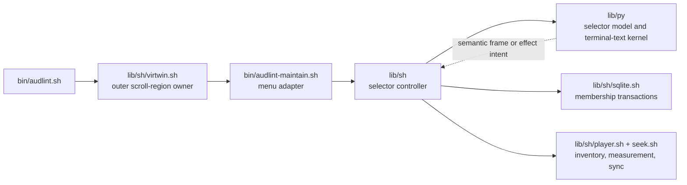

# Architecture Spine — Player Content Navigation and Selection

## Design Paradigm

**Functional Core / Imperative Shell.** One Bash controller owns terminal and workflow effects. One persistent Python model owns selector semantics and session state. SQLite and player operations remain shared shell services.



## Invariants & Rules

### AD-1 — Adopt the repository dependency boundary [ADOPTED]

- **Binds:** CAP-1–CAP-7; ADR-0006
- **Prevents:** A second UI state machine or shared policy growing inside the entry script.
- **Rule:** `bin/audlint-maintain.sh` adapts the menu to one shared Bash selector controller. The controller alone dispatches effects through `lib/sh/sqlite.sh`, `lib/sh/player.sh`, `lib/sh/seek.sh`, and shared terminal helpers. An importable `lib/py` model performs tree, projection, focus, Help, result-priority, Unicode, and layout computation. Python never opens the TTY, writes SQLite, or invokes synchronization.

### AD-2 — Partition inventory, durable membership, and session state

- **Binds:** CAP-1–CAP-5, CAP-7
- **Prevents:** Projection state changing membership, concurrent semantic owners, or missing checked paths disappearing.
- **Rule:** At entry, complete the filesystem inventory and read the complete persisted checked set. One shared shell inventory/path owner accepts ordinary `index/artist/release`, direct `_VA/release`, and nested `_VA/year/release` identities; reconstructs absent persisted metadata through the same parser; groups both `_VA` shapes under `_VA`; and rejects an unparseable persisted identity by failing selector entry without deleting it. It emits the final live-plus-persisted rows in the existing artist sort-key, numeric-year, album sort-key order, using literal relative path only to stabilize an otherwise equal row. Python treats this emitted order and its keys as opaque and never resorts it; search normalization does not redefine sort. Python owns that immutable inventory plus session-local availability/measurement overlay, expansion, view, focus anchor, applied query and draft, Help position, busy state, result, projection, and viewport until exit. `player_content_selection`, keyed by validated library-relative path, is the only durable membership authority; reopening rebuilds the session.

### AD-3 — Use one membership mutation path

- **Binds:** CAP-3
- **Prevents:** Partial artist changes, album/artist SQL drift, and repaint before persistence.
- **Rule:** A model event yields a scoped delta for exactly one album path or one complete artist identity. The intent carries that scope's expected checked paths plus disjoint, duplicate-free add and remove path sets; rows outside the scope are never replacement candidates. The controller validates and measures every addition through shared player snapshot helpers, then one `lib/sh/sqlite.sh` `BEGIN IMMEDIATE` transaction first verifies the scope still equals the expected set and applies the complete delta. A mismatch or any measurement, validation, or database failure commits nothing. On mismatch, the controller returns the fresh authoritative checked set in the correlated `done` update; the model refreshes known frozen identities and retains a mismatch error. A new or invalid identity outside the frozen inventory terminates Player Content without mutation and requires fresh entry. Only a successful commit acknowledgement changes membership for the requested effect. Artist additions measure all new paths before the transaction; artist removals include unavailable checked paths without measurement.

### AD-4 — Centralize Unicode and terminal-text semantics

- **Binds:** CAP-2, CAP-6
- **Prevents:** Different byte, code-point, grapheme, case, and display-cell meanings across search, editing, focus, and rendering.
- **Rule:** One importable Python terminal-text kernel supplies NFC normalization followed by full `str.casefold`, literal matching, grapheme boundaries, sanitization, display-cell measurement, clipping, and caret placement. It implements UAX #29 extended grapheme breaking from checked-in Unicode 14.0.0 Grapheme Break and Extended Pictographic ranges; selector entry rejects a configured Python whose parsed `unicodedata.unidata_version` is below 14.0.0, and table upgrades change the version marker and conformance fixtures together. NFC/casefold behavior for characters added after 14.0 is runtime-relative and tested on each supported distro, not promised byte-identical across Unicode versions. The supported width profile is a non-CJK UTF-8 locale: one measurable printable base determines width, East Asian Wide/Fullwidth bases are two cells, Ambiguous/Narrow/Neutral/Halfwidth bases are one, and combining/format continuations add zero. Extended-Pictographic, regional-indicator, keycap, modifier, ZWJ, variation-presentation, unsupported/unassigned/private-use/surrogate/control, or base-less clusters are width-variable and render as exactly one `?` cell without changing identity; they are not accepted into search input. A non-UTF-8 or CJK-width locale selects the contract's ASCII glyphs, one-cell replacement rendering for all non-ASCII clusters, ASCII-only search entry, and bounded feedback. No libc or undeclared `regex`/`wcwidth` dependency defines semantics, and no caller implements a second algorithm.

### AD-5 — Keep the Bash/Python boundary framed and non-executable

- **Binds:** CAP-1–CAP-6
- **Prevents:** Ambiguous records, argv growth, partial-state reads, or user text becoming shell syntax.
- **Rule:** Resolve the configured `AUDL_PYTHON_BIN`, enforce AD-4's Unicode floor, launch the model unbuffered, close unused parent/child descriptors, and permit exactly one outstanding request. Every record is `PC1 US request-id US kind US fields... LF`; US and LF are the only framing controls and may not occur in fields. `INIT`, `EVENT`, and `EFFECT_UPDATE` carry current rows, columns, destination presence, and informational free bytes so every returned frame uses one fresh observation; `EVENT` is only `key` or `resize`, while `EFFECT_UPDATE` is only correlated `progress` or `done`. Model replies are `STATE(frame-artifact,caret-row,caret-col,effect-id-or-empty,effect-kind-or-empty,effect-artifact-or-empty)` or `FATAL(code,text)`; effect kinds are `measure-checked`, `mutation`, `sync`, and `quit`. After `INIT`, any checked rows require a `measure-checked` effect before a ready frame. The controller creates one mode-0700 protocol directory through shared portable secure-temp policy outside protected roots and allocates every artifact destination inside it. The producer writes a restrictive stage file, closes and checks it, then atomically replaces the supplied destination; the consumer validates before use, and the controller removes the whole owned directory after the child is reaped on normal, fatal, timeout, signal, and trappable exits. Both sides reject unknown kinds, cardinality, versions, oversize, truncation, request mismatch, or embedded controls. Timeout, EOF, crash, or rejected/lost reply stops effects, never retries an ambiguous mutation, terminates/reaps the child, restores the terminal, and requires fresh entry from SQLite. No ANSI, `eval`, sourced shell, or command-substituted user data crosses the boundary.

### AD-6 — Derive every projection in one fixed order

- **Binds:** CAP-1–CAP-3, CAP-7
- **Prevents:** Search, view, expansion, or Current changing complete-group truth or synchronization scope.
- **Rule:** The model derives `membership snapshot → All/Checked/Unchecked child filter → NFC/casefold literal query → empty-parent pruning → expansion → visible rows → focus-anchor resolution → viewport`. An artist-name match admits every child surviving the view; an album-only match admits matching children. Artist tri-state, count, and payload always use the complete unprojected group. Synchronization bypasses this pipeline and rereads the complete ordered checked set from SQLite.

### AD-7 — Give one controller the complete terminal lifecycle [ADOPTED]

- **Binds:** CAP-5–CAP-7; ADR-0003; ADR-0009
- **Prevents:** Nested raw-mode owners, replayed input, split escape parsing, double restoration, or writes outside the selector canvas.
- **Rule:** `virtwin.sh` remains the sole owner of the outer Maintenance scroll region: it establishes the selector canvas and restores that region once when the enclosing virtual window exits. The selector controller never emits a scroll-region sequence; on resize it synchronously calls the shared virtwin geometry helper, which preserves the fixed top, updates the actual bottom/width, and returns the acknowledged canvas before the controller sends `EVENT(resize)` and paints. Inside that canvas, one Bash controller saves the original TTY once and exclusively owns raw mode, the CSI/SS3 parser and partial sequence, caret, fixed-canvas painting, model lifecycle, Help/search dispatch, measurement and synchronization handoff, and input draining. Transfer/progress workers emit framed semantic updates and never write the TTY. During foreground work the controller treats resize only as layout, discards other queued bytes, clears parser state, and sends one completion event. Its finalizer terminates/reaps the model before restoring original TTY, echo, and caret exactly once. Every primary action remains keyboard reachable; `NO_COLOR`, text/symbol meaning, complete Help at every supported size, display-cell safety, and fixed-column ASCII fallbacks remain intact. These are baseline terminal guarantees, never a screen-reader mode or conformance claim.

### AD-8 — Render one bounded semantic frame

- **Binds:** CAP-4–CAP-6
- **Prevents:** Mode-specific warning/result rules, narrow-terminal data loss, wraps, and ANSI injection.
- **Rule:** Outside foreground work, every accepted key or coalesced resize becomes one model `EVENT`; while busy, the controller discards ordinary bytes and partial sequences without parsing or forwarding, coalesces resize to the latest acknowledged geometry, and sends only resize plus correlated `EFFECT_UPDATE` records. Every request carries fresh destination observations, returns one complete semantic `STATE`, and only that frame may be painted. Python emits plain rows and a caret cell already sanitized and clipped by display cells; Bash adds existing color roles and ANSI positioning and incrementally paints the fixed canvas. Initial `measure-checked` sizes the complete checked set only. Any checked path that is unavailable or unmeasurable stays checked, makes its album, artist, and global payload unknown, and blocks `w`; accepted `w` first remeasures unknown checked paths and proceeds only if the refreshed complete snapshot succeeds, while identity/order stay frozen. Uncheck remains available without measurement, and a human size renders only when every contributor is known. Destination presence/free space are informational, never readiness gates. Chrome abbreviates a safe destination label only when needed; Help retains the full validated destination. Persistent context and zero-checked scope occupy chrome; the result slot priority is `error > success > information`. Passive repaint, navigation, expansion, Help, and resize preserve it; view/query clears success/information but not errors; relevant effect start clears its prior result; progress cannot replace error; completion installs error or success for at least one stable repaint. Rejected input, malformed paste, boundary no-op, and blocked unavailable additions are information; empty inventory/projection is persistent body context; error is reserved for accepted measurement, mutation, protocol, preflight, transfer, flush, source, or destination failure. Below `12×20`, state remains resident and only `q` and resize dispatch outside foreground work.

### AD-9 — Consume the accepted synchronization pipeline once [ADOPTED]

- **Binds:** CAP-7; ADR-0007; ADR-0008; Player Track-Only Exact Mirror; Player Content Live Rsync Progress
- **Prevents:** A projection-relative sync, a second payload/rule/deletion implementation, or progress changing authoritative outcomes.
- **Rule:** One controller adapter invokes the established sequence: complete SQLite checked-set snapshot; complete shared source/destination/tool safety and writability preflight with no second confirmation; one newly completed secure file-backed eligible-track snapshot that is the sole source for album/global logical bytes and transfer membership; one compiled file-backed ordered merge filter; final checked-set and destination revalidation; one fixed-argv root rsync; flush; source-stability check; destination postcheck; failure preservation; and fresh-artifact retry. Every pre-rsync failure invokes no transfer. The adapter contributes no alternate walk, per-album/per-track rule arrays, projection data, or terminal writer. A transfer worker retains capability probing and fallback but sends only sanitized bounded aggregate records to the controller; fallback sends one bounded busy state. The adapter never duplicates eligibility, sizing, rules, zero-checked deletion, preflight, postcheck, failure, or retry policy.

### AD-10 — Preserve isolated and portable proof seams [ADOPTED]

- **Binds:** CAP-1–CAP-7; ADR-0004
- **Prevents:** PTY-only logic becoming untestable or automated proof touching operator resources.
- **Rule:** Pure Python tests cover the model, 1,600-row projections, focus, Help, result priority, Unicode 14.0 grapheme fixtures, and conservative cell measurement; PTY screen assertions use the same cell-aware oracle rather than one-code-point-per-cell emulation. Protocol tests cover interpreter resolution, unbuffered request/reply order, descriptor closure, timeouts, embedded LF/US, truncation, size limits, unknown versions, request mismatch, EOF/crash, termination/reaping, and commit-with-lost-ack. Temporary SQLite tests cover scoped compare-and-apply transactions and rollback. Shared player fixtures with stubbed rsync, mount/presence, and flush tools cover snapshot/rule identity, complete preflight, progress fallback, source/destination postchecks, and retry. An adapter test varies view, query, focus, expansion, and collapse over one durable checked set and requires identical manifests; zero checked keeps root-deletion scope, while an unknown checked path stops before transfer. Temporary-fixture PTY tests cover CSI/SS3 input, acknowledged virtwin resize, busy draining, rendering, synchronization handoff, signals, and exactly-once restoration. Source-location assertions move to the shared controller or become behavioral assertions. The Bash 5 gate and affected macOS/Linux checks exercise the configured Python Unicode-data floor, UTF-8/ASCII fallback, protocol lifecycle, key parser, and production cell policy. No automated seam touches an operator library, live database, or mounted destination.

## Consistency Conventions

| Concern | Convention |
| --- | --- |
| Identity | Validated library-relative path is the album key everywhere; display labels are never keys. |
| Language | Use **Current** for focus, **Checked** for durable membership, and **View** for projection. |
| Effect protocol | Model requests effects; only committed effect results may update semantic state. |
| Errors | Name the failed action or synchronization stage; preserve prior semantic and durable state unless a transaction committed. |
| Terminal data | Model data is control-free plain text; ANSI exists only in the Bash renderer. |

## Protocol v1

| Direction / artifact | Fixed schema |
| --- | --- |
| Controller → model | `INIT`, then serialized `EVENT(key\|resize)`, `EFFECT_UPDATE(effect-id,progress\|done)`, or `STOP`; every frame-producing request carries current geometry, destination presence, and informational free bytes. |
| Model → controller | Exactly one correlated `STATE` or `FATAL`; `STATE` contains one complete frame and at most one `measure-checked`, `mutation`, `sync`, or `quit` effect intent. |
| `inventory.v1` | One row per frozen album: path, source-or-empty, artist display/key, numeric year, album display/key, available `0/1`, checked `0/1`, size `known/unknown`, decimal bytes-or-empty. |
| `frame.v1` | One row per canvas row: stable row id, semantic/color role, plain bounded text; caret row/cell travels in `STATE`. |
| `measure-checked.v1` | Effect id plus the complete ordered checked paths; updates carry stage, completed/total, and final per-path availability/size rows. |
| `mutation.v1` | Scope kind/key, expected checked paths, add paths, and remove paths; measured add sizes are controller-owned inputs to the SQLite transaction, not model truth. |
| `sync.v1` | Effect id only; the controller adapter rereads SQLite and accepts no inventory, projection, or path payload from the model. Updates carry bounded stage/progress and one final outcome. |

All enums are ASCII tokens, integers are unsigned decimal, booleans are `0`/`1`, and variable rows use the AD-5 US/LF framing. A single checked-in protocol validator fixture is authoritative for both sides.

## Structural Seed

```text
bin/audlint-maintain.sh       # Maintenance entry and menu adapter
lib/sh/virtwin.sh             # sole outer Maintenance scroll-region owner
lib/sh/                       # selector/TTY controller, SQLite, inventory, and player effects
lib/py/                       # pure selector model and terminal-text computation
test/                         # pure model, SQLite/helper, and temporary-fixture PTY proof
```

Current helpers are the seed: extend `sqlite.sh`, `player.sh`, `seek.sh`, and shared terminal helpers rather than introducing parallel policy. Exact new helper and module names belong to implementation.

## Capability → Architecture Map

| Capability | Lives in | Governed by |
| --- | --- | --- |
| CAP-1 Tree navigation | Python model; Bash controller | AD-1, AD-2, AD-6, AD-7 |
| CAP-2 Search and views | Python terminal-text kernel and model | AD-4, AD-5, AD-6 |
| CAP-3 Membership changes | Model intents; shell measurement; SQLite transaction | AD-2, AD-3 |
| CAP-4 Chrome and results | Python semantic frame; Bash renderer | AD-2, AD-8 |
| CAP-5 Help | Python model; Bash event dispatch | AD-2, AD-7, AD-8 |
| CAP-6 Terminal floor | Bash controller; Python terminal-text kernel | AD-4, AD-7, AD-8, AD-10 |
| CAP-7 Synchronization | Existing shared player pipeline through one controller adapter | AD-6, AD-7, AD-9, AD-10 |

## Resolved Input Conflicts

- The current completed-inventory reconciliation deletes checked paths that disappear. This conflicts with the binding unavailable-checked contract. Preserve those paths as unavailable rows and replace the obsolete purge expectation.
- The current inventory omits nested `_VA/year/release` albums. This conflicts with the binding hierarchy proof for nested and direct `_VA` paths. The shared identity parser and inventory must admit both shapes under one `_VA` group and replace the obsolete exclusion expectation.
- The current Player Content progress path and tests render itemized transcript lines. This conflicts with the binding rsync-feedback companion, whose non-goals exclude filename-level transcripts. Preserve aggregate capability probing and fallback; remove transcript behavior from this feature path.

## Deferred

- Exact helper/module names and internal function decomposition: the dependency and ownership rules already constrain them.
- Model-process startup mechanics, buffering sizes, and repaint-cache strategy: choose during implementation and prove through AD-5/AD-8 seams.
- Broader terminal-helper refactoring and other TUI migration: no cross-story divergence in this feature requires it.
- Saved expansion, view, query, Help, focus, results, or measurement cache: only checked membership is durable by contract.
- Network services, providers, daemons, background work, deployment topology, and new package management: this remains a local foreground CLI on the inherited Bash 5 macOS/Linux floor.
- Specialized screen-reader behavior or conformance: requires separate product intent and a decision superseding ADR-0009.
