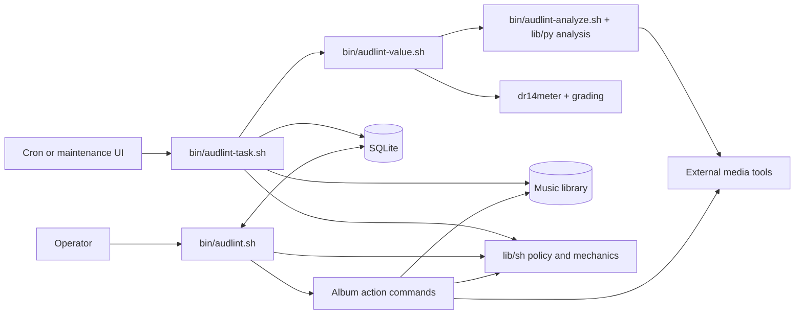

# Architecture Overview

> Current architecture, verified on 2026-08-29 against `2601437`. This document describes existing code and behavior only; code and tests remain authoritative.

## Architectural shape

Audlint is a local, modular shell pipeline with Python analysis kernels and a SQLite operational catalog. Bash entry commands own interaction and workflow control, shared Bash libraries own cross-command policy and mechanics, and Python modules own signal analysis, grading, image analysis, and rendering. [ADR-0006](../decisions/0006-ADR-shell-python-responsibility-boundary.md) records this preferred responsibility boundary and its exceptions.

Audio files and embedded tags are authoritative for media content. SQLite stores derived quality results and scan queues alongside mutable operator flags, annotations, and fetched lyrics; do not assume that the database is wholly reconstructible without loss. [ADR-0001](../decisions/0001-ADR-music-library-authority-and-sqlite-state.md) records this authority and persistence boundary.

## Major components

| Component | Responsibility |
| --- | --- |
| `bin/audlint.sh` | SQLite-backed TUI for browsing, filtering, inspection, annotations, and orchestration of maintenance, analysis, recode, lyrics, transfer, sync, and removal actions. |
| `bin/audlint-maintain.sh` | Maintenance UI for manual scans, managed cron installation/removal, logs, artwork, gain, and player cleanup. |
| `bin/audlint-task.sh` | Single-run scheduled scanner: persisted discovery queue, album probing, optional genre enrichment, quality analysis, SQLite upserts, and task logging. |
| `bin/audlint-analyze.sh`, `bin/audlint-value.sh`, and analysis modules in `lib/py/` | Spectral/recode analysis, fake-upscale classification, DR14 measurement and grading, and structured quality output. |
| `bin/any2flac.sh`, `bin/cue2flac.sh`, `bin/dff2flac.sh`, and `bin/boost_album.sh` | Conversion, split, recode, and gain workflows using shared codec, encoder, metadata, artwork, and backup mechanics where implemented. |
| `bin/cover_*`, `bin/lyrics_*`, `bin/tag_writer.sh`, and `bin/sync_music.sh` | Artwork normalization, lyrics caching/embedding, format-specific tag writes, and rsync mirroring. `*_seek.sh` commands recursively apply album-level operations. |
| `bin/audlint-doctor.sh`, `bin/qty_compare.sh`, dataset/corpus commands, and spectrogram commands | Runtime diagnostics, comparisons, and analyzer and image-validation support. |

## Shared libraries and dependency direction

The normal dependency direction is `bin/*` orchestration → `lib/sh/*` policy and mechanics → `lib/py/*` computation. Commands may delegate to other commands; `audlint-task.sh` also sources the library-like `bin/tag_writer.sh`.

| Shared area | Ownership |
| --- | --- |
| `lib/sh/bootstrap.sh`, `lib/sh/env.sh`, `lib/sh/deps.sh` | Portable path/TTY handling, trusted `.env` loading and expansion, PATH setup, and executable checks. |
| `lib/sh/audio.sh`, `lib/sh/ffprobe.sh`, `lib/sh/profile.sh`, `lib/sh/codec_caps.sh` | Supported audio discovery, cached media probing, codec capability routing, and profile normalization. |
| `lib/sh/encoder.sh`, `lib/sh/artwork.sh`, `lib/sh/lyrics.sh`, `lib/sh/secure_backup.sh` | Encoding and tag preservation, canonical artwork post-processing, lyrics cache mechanics, and opt-in paranoia backups. |
| `lib/sh/sqlite.sh` | Schema lifecycle, normalized/indexed columns, primary album upserts, roadmap queue, query helpers, and rotating database backups. |
| `lib/sh/seek.sh`, `lib/sh/ui.sh`, `lib/sh/virtwin.sh`, `lib/sh/table.sh`, `lib/sh/rich.sh` | Recursive album traversal and terminal presentation. |
| `lib/py/` | FFT/recode decisions, DR grading, track matching, genre lookup, spectrogram image and OCR analysis, and Rich rendering. |

## State and storage

| State | Owner and role |
| --- | --- |
| Music library | Authoritative audio, embedded tags, artwork, and album layout. Analysis and maintenance read it; action commands and genre enrichment may mutate it. |
| `AUDL_DB_PATH` SQLite database | `album_quality` stores derived browser/index data plus operator-managed state; `player_content_selection` stores checked Player Content library-relative paths and cached payload bytes; `scan_roadmap` is the persisted work queue; `lyrics_cache` stores found/not-found outcomes and fetched text; `app_meta` and optional FTS5 support internal contracts and search. WAL is requested for concurrent read-heavy browsing and batch writes. |
| Derived sidecars | Album-local `.sox_album_profile`, `.sox_album_done`, `.audlint_album_art`, `.audlint_inspect_cache.json`, and `any2flac.sh` true-peak TSV files cache analysis or post-process results. The DFF true-peak TSV lives in its configured output directory. Analysis is not strictly read-only. |
| Operational state | A discovery timestamp beside the database, a global scan lock under `/tmp`, a task log, adjacent daily/weekly/monthly DB ZIP bundles, and album-local `before-recode/` staging owned by `boost_album.sh`. |
| Configuration and scheduling | Most commands source trusted shell `.env` configuration with command-specific discovery rules. `audlint-maintain.sh` consumes inherited `AUDL_*` values and owns a delimited crontab block that invokes `audlint-task.sh`. |

## Important flows

### Maintenance and indexing

1. `audlint-task.sh` resolves configuration, initializes or migrates SQLite, checks database integrity, refreshes backup bundles when due, and acquires the scan lock.
2. It drains existing `scan_roadmap` work, discovers new or changed album directories, persists that work, then drains the new queue within configured limits.
3. For each album, it probes the first recognized track for identity, rejects albums with mixed codecs or profiles as scan failures, optionally resolves and writes a missing genre tag, and invokes `audlint-value.sh`.
4. `audlint-value.sh` combines spectral analysis from `audlint-analyze.sh` with `dr14meter` output and Python grading, then emits JSON.
5. The task validates that JSON and upserts the `album_quality` record consumed by the browser.

### Interactive actions

1. `audlint.sh` queries SQLite for views, search, filters, keyset paging, and inspection.
2. Mutating actions delegate to focused commands such as `any2flac.sh`, `lyrics_seek.sh`, and `sync_music.sh`; shared libraries provide the relevant format, profile, backup, and terminal mechanics.
3. File mutations change the music library directly. Later maintenance reconciles derived SQLite state; some browser actions also update rows immediately.

### Player Content

Player Content is a deliberate path-identity exception to the catalog's
natural album identity. Maintenance first completes a bounded inventory of
`<index>/<artist>/<album>` and `_VA/<album>` directories, derives display names
from those relative paths, and then overlays checked rows from
`player_content_selection(relative_path, size_bytes)`. The browser and scanner
continue to use `album_quality` and its natural identity. A rename is therefore
a dropped checked path plus a new unchecked path, not an inferred continuation.

Both Player Content and browser transfer use one completed, track-only source
snapshot per requested album. A track is a non-symlink regular file with a
canonical audio extension and no hidden path component. The snapshot supplies
the cached byte count and a temporary ordered rsync rule file; it is rebuilt
after copying to confirm source stability. Player Content owns and exactly
mirrors the whole validated player root. Browser transfer exactly mirrors only
the requested library-relative album subtrees. Neither workflow reports success
until rsync, flush, and the owned destination path/type/size comparison pass.
Transfers preserve content and paths, not source ownership, permissions, or
timestamps, so removable filesystems do not create AppleDouble `._*` sidecars.
They use `--size-only`, so equal-size tracks do not copy again solely because
their destination timestamps intentionally differ.
When its installed rsync advertises `--info`, Player Content streams only
aggregate `progress2` records into the selector's bounded title-status field.
This is optional live feedback: the single root mirror, its exit status, and
the final postchecked result remain authoritative.

## Cross-component contracts

- Profile normalization produces `SR_HZ/BITS`, where `BITS` can be an integer, `32f`, or `64f`. Analyzer and recode machine boundaries currently require targets with integer `BITS` values.
- Catalog album identity comes from the first recognized track, prefers `album_artist`, falls back to path names, and normalizes an invalid year to `0`. `(artist_lc, album_lc, year_int)` is unique; `source_path` is indexed but not unique, and the task prunes stale identities for a path. Player Content deliberately does not use that identity: its checked state is keyed by a validated library-relative filesystem path. See [ADR-0002](../decisions/0002-ADR-natural-album-identity.md).
- In default mode, `audlint-analyze.sh` can emit a canonical target or the successful literal `Re-encoding not needed`; consumers that require a target then read `.sox_album_profile`. JSON mode is the detailed analysis boundary.
- `audlint-value.sh` emits the quality JSON consumed by the scanner, comparison flow, and browser inspection. Scanner success requires nonempty `recodeTo`, `drTotal`, and `grade` values; consumers supply defaults for other fields.
- `lib/sh/sqlite.sh` owns schema migration, primary upsert behavior, and the path-keyed Player Content selection schema. Callers preserve its normalization and derived-index columns rather than defining competing schema contracts.
- Exit status is part of command composition: recursive seekers aggregate album failures, and parents treat nonzero child status as failure unless a command defines a successful no-op.
- Conversion paths use `encoder.sh` functions where implemented; commands still contain format-specific FFmpeg and tag logic. Shared artwork post-processing remains the common completed-album contract.

## Safety boundaries

- Before rotating adjacent daily/weekly/monthly ZIP bundles, the database helper checks the live database's integrity and validates archive structure. These bundles are operational file-copy backups; they do not provide a documented guarantee of transaction-consistent snapshots.
- Task runs are serialized by a global lock. Missing or unwritable library or database paths cause the task to skip scanning or fail before scanning begins.
- When the database is read-only, the browser disables database-dependent mutations such as row edits, recode, lyrics, full remove, and purge. Independent filesystem or operational actions—including sync, player transfer, inspection-cache generation, and maintenance—remain available with their own safeguards.
- `AUDL_PARANOIA_MODE=1` activates the shared pre-write album backup guard. It verifies the configured paths and copied audio files, but it is opt-in, does not cover every mutation command, and does not prove that the backup path is on a distinct device or outside the library.
- `any2flac.sh` rejects lossy sources unless explicitly overridden, blocks target profiles above the source, and stages each replacement through a temporary FLAC. `cue2flac.sh` caps its output profile to the lowest referenced source. Other conversion and rewrite commands have command-specific safeguards.
- `sync_music.sh` uses `rsync --delete` and checks only that the destination is a writable directory. Its `--dry-run` still removes `._*` and `.DS_Store` files from the source before invoking rsync. Player Content performs its own source-relative mirror preflight and does not use the scanner's catalog identity or destination contents as inventory.
- Default unit and smoke tests use temporary fixtures and stub external tools. An end-to-end test that uses the real crontab requires explicit `AUDLINT_USE_REAL_CRONTAB=1` opt-in; repository policy still forbids automated verification against real music libraries, databases, backup destinations, or sync targets. See [ADR-0004](../decisions/0004-ADR-real-resource-verification-safety.md).

## External dependencies

Dependencies are command-scoped; each command performs its own checks, and `audlint-doctor.sh` reports broad readiness.

| Capability | Dependencies and integrations |
| --- | --- |
| Broad base | Bash 5, configured Python 3, FFmpeg/ffprobe, SQLite, and rsync. Browser, scanner, backup, lyrics, image, and tagging features add their own requirements. [ADR-0003](../decisions/0003-ADR-bash5-portability.md) records the Bash and platform portability rule. |
| Analysis and encoding | NumPy, `dr14meter`, SoX/`soxi`, FFmpeg, and `metaflac`. Encoder paths select SoX or FFmpeg by capability, but analyzer metadata probing currently still invokes `soxi` even when FFmpeg decoding is selected. |
| Tags, artwork, and lyrics | `eyeD3`, AtomicParsley, `vorbiscomment`, `opustags`, `wvtag`, `curl`, and `jq`, depending on format and feature. |
| Terminal and image tools | The Python `rich` package; OpenCV/NumPy and Tesseract for spectrogram image analysis. |
| Operations | `zip`/`unzip` for database bundles, `crontab` for scheduling, and standard Unix tools. |
| Remote services | Genre enrichment tries MusicBrainz, then Discogs, and then Last.fm if `AUDL_LASTFM_API_KEY` is set. Explicit missing-art fetch uses MusicBrainz and Cover Art Archive; lyrics uses LRCLIB. |

## Build, installation, and verification

- There is no compiled build artifact. `make install` symlinks `bin/*.sh` commands and aliases into `PREFIX`; `install.sh` generates `.env` only.
- `bin/audlint-source-audit.sh` is a developer-only, fail-closed Git safety gate. Its staged policy is the runtime authority; it is not installed as a product command. See [ADR-0005](../decisions/0005-ADR-source-control-safety-gate.md).
- `make test` is the fast local Python loop. `make test-integration` runs the integration and deep-regression tier, while `make test-all` runs their explicit, disjoint union exactly once.
- `make check` is the local release gate: ShellCheck, formatting check, Bash 5 consistency, `test-all`, then the authoritative source audit. Use the closest `python3 -m unittest` module or named test while iterating; reserve `make check` for release verification. `make test-spectre` remains a focused spectre smoke target.
- `test/distro/*_check.sh` provides targeted distribution checks. No CI workflow is tracked; the local Makefile gate remains authoritative.
